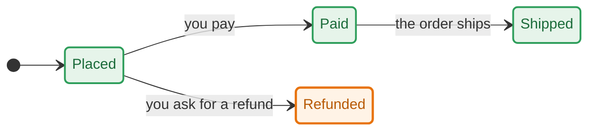
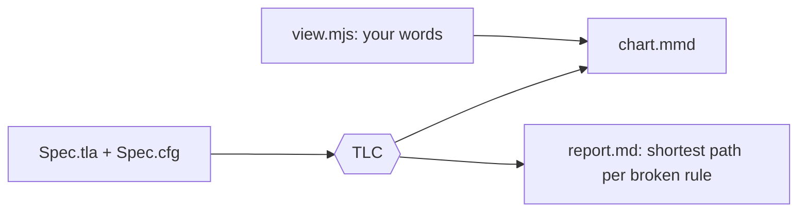
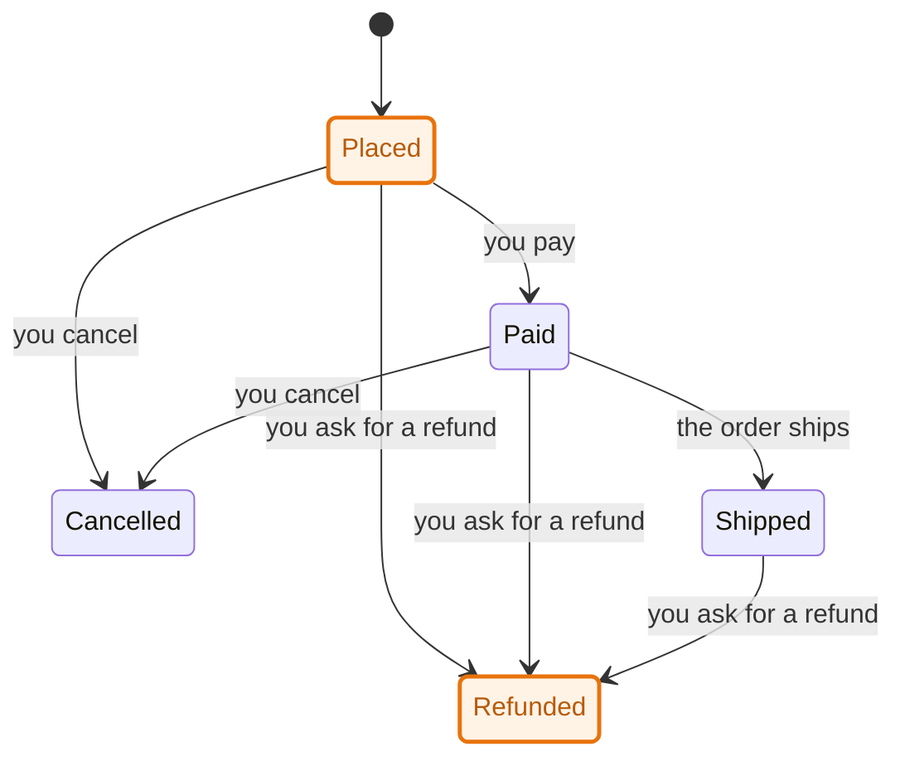

# tlachart

[](https://github.com/nchandar/tlachart/actions/workflows/ci.yml)
[](https://www.npmjs.com/package/tlachart)
[](LICENSE)

Your TLA+ spec, drawn.

- Give it a spec. TLC checks every rule.
- Get a chart of the states, in your words.
- Get the shortest path to each bug, so you can see it and argue with it.



| Path          | Steps                 | Verdict                                                         |
| ------------- | --------------------- | --------------------------------------------------------------- |
| Happy (green) | Placed, Paid, Shipped | the rule holds                                                  |
| Bug (orange)  | Placed, Refunded      | refund with no payment: the rule `NoRefundBeforePayment` breaks |

## Example

An order. The rule: no refund before payment.

**You write** the spec ([`Order.tla`](examples/order/Order.tla)) and a view that names things:

```tla
Pay           == status = "placed" /\ status' = "paid" /\ paidEver' = TRUE
RequestRefund == status \in {"placed", "paid", "shipped"} /\ status' = "refunded" /\ UNCHANGED paidEver

NoRefundBeforePayment == status /= "refunded" \/ paidEver
```

```js
// view.mjs
export const state = (v) =>
	({
		placed: "Placed",
		paid: "Paid",
		shipped: "Shipped",
		cancelled: "Cancelled",
		refunded: "Refunded",
	})[v.status];
export const step = (action) =>
	({ Pay: "you pay", RequestRefund: "you ask for a refund" })[action] ?? action;
```



**You run:**

```sh
tlachart Order.tla --view view.mjs
```

**You get** a chart (`chart.mmd`) and a report (`report.md`):



```
## NoRefundBeforePayment breaks
The shortest path has 1 step:
0. Placed
1. you ask for a refund: Refunded

## Rules that hold
NoDeadlock
```

Orange is the shortest path to the bug. Exit code 1 means a rule broke, so CI can fail on it.

More: [Checkout](examples/checkout) (front end, parallel regions), [Retry](examples/retry) (back end, idempotency), [Order](examples/order) (groups and colors). Each has a buggy and a fixed spec.

## Install

| Tool | Run once                     | Install                   |
| ---- | ---------------------------- | ------------------------- |
| bun  | `bunx tlachart SPEC.tla`     | `bun add -g tlachart`     |
| pnpm | `pnpm dlx tlachart SPEC.tla` | `pnpm add -g tlachart`    |
| npm  | `npx tlachart SPEC.tla`      | `npm install -g tlachart` |

| Needs | Version      | Note                                                                                                                                        |
| ----- | ------------ | ------------------------------------------------------------------------------------------------------------------------------------------- |
| Bun   | 1.1.39+      | runs the command, on PATH                                                                                                                   |
| Java  | 11+          |                                                                                                                                             |
| TLC   | 1.7.4        | set `TLA2TOOLS=/path/to/tla2tools.jar`, or install [mise](https://mise.jdx.dev) and the command fetches Java and TLC for you (about 535 MB) |
| OS    | macOS, Linux |                                                                                                                                             |

## Usage

```sh
tlachart SPEC.tla [--config FILE] [--view FILE] [--out DIR]
```

| Flag       | Default                    | Does                               |
| ---------- | -------------------------- | ---------------------------------- |
| `--config` | `SPEC.cfg` beside the spec | TLC config                         |
| `--view`   | each state's raw values    | module that picks the words        |
| `--out`    | `SPEC-chart/`              | new or empty folder, not a symlink |

Writes `chart.mmd`, `report.md`, `tlc.out`, and `tlc-RULE.out` per broken rule. Paste `chart.mmd` into a fenced `mermaid` block on GitHub.

| Exit     | Meaning                     | Output  |
| -------- | --------------------------- | ------- |
| 0        | every rule holds            | written |
| 1        | a rule breaks               | written |
| 2        | TLC error, or could not run | none    |
| 130, 143 | SIGINT, SIGTERM             | none    |

### The view

| Export                   | Returns                                                                       | Needed       |
| ------------------------ | ----------------------------------------------------------------------------- | ------------ |
| `state(vars)`            | string (flat), array (parent states), or object (one parallel region per key) | yes          |
| `step(action, from, to)` | words for the arrow, or `null` to hide it                                     | no           |
| `group(vars)`            | phase name                                                                    | no           |
| `colors`                 | `{ phase: blue \| orange \| purple \| yellow \| teal \| tan \| pink }`        | with `group` |
| `title`                  | string on top of the chart                                                    | no           |

`vars` is plain JSON: a TLA+ sequence is an object keyed from 1, a set is an array. Keep a chart near 20 arrows.

### Reading the chart

| Mark       | Meaning                                                      |
| ---------- | ------------------------------------------------------------ |
| `breaks`   | the rule breaks in every model state behind this chart state |
| `mayBreak` | it breaks in some of them                                    |
| `bugPath`  | on the shortest path to a bug                                |
| `repeats`  | a liveness counterexample loops through it                   |

### Limits

| Limit                       | Value                                                                    |
| --------------------------- | ------------------------------------------------------------------------ |
| Chart size                  | 500 states. Above it only the paths to broken rules are drawn            |
| After the first broken rule | reruns stop at 100,000 states; the rest is listed as "Rules not checked" |
| TLC workers                 | 1, so shortest paths are stable                                          |
| `+` or `<=` in a spec       | add `EXTENDS Naturals`                                                   |

### Trust

A spec, its `.cfg`, any `.jar` beside it, and the `--view` module all run as you, with no timeout or memory cap. Use specs you trust, or run in a container.

## From source

```sh
git clone https://github.com/nchandar/tlachart && cd tlachart
bun install --frozen-lockfile
export TLA2TOOLS=$HOME/.local/share/tla/tla2tools.jar
bun src/cli/main.ts examples/order/Order.tla --view examples/order/view.mjs --out /tmp/order-chart
```

`bun run check` runs typecheck, lint and format. `bun test` runs the tests. `bun run model` and `bun run model:variants` check the TLA+ model of the command's own output handling ([formal/coverage.md](formal/coverage.md)).

## Credits

Inspired by the `statechart` skill in Lauren Tan's [pstack](https://github.com/cursor/plugins) (MIT, [LICENSE-pstack](LICENSE-pstack)). Built on [TLC](https://github.com/tlaplus/tlaplus) and [Mermaid](https://mermaid.js.org). MIT, see [LICENSE](LICENSE).
